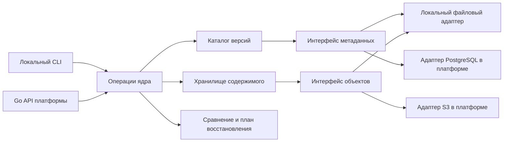

# Архитектура ядра версионирования

Статус: проект для обсуждения, 27 октября 2026 года. Здесь описана предполагаемая система, а не реализованные функции или утверждённое техническое задание.

## Задача и граница

Пользователь должен суметь ответить, какая версия данных, кода и настроек породила результат, чем два состояния отличаются и какие материалы нужны для восстановления выбранного запуска. Для первой проверки достаточно одного учебного ML-пайплайна и нескольких последовательных версий.

Ядро отвечает за правила версионирования, неизменяемые записи и проверку ссылок. Учетные записи, права на проекты, HTTP API, интерфейс и фактическое выполнение ML-кода относятся к платформе. Проверка доступа выполняется до вызова ядра. Код проекта может храниться в обычном Git; крупные данные и артефакты передаются в хранилище объектов через адаптер.

## Предметная модель

| Объект | Смысл | Что сохраняется |
| --- | --- | --- |
| Репозиторий исследования | Пространство версий одного проекта. Идентификатор выдаёт вызывающее приложение. | Ссылки на наборы данных, описания экспериментов и запуски. |
| Версия датасета | Неизменяемое описание конкретного набора файлов. | Пути внутри набора, размеры и контрольные суммы содержимого, ссылка на предыдущую версию при наличии. |
| Снимок условий эксперимента | Неизменяемая версия описания предполагаемого запуска. | Одна или несколько версий входных датасетов, ссылка на коммит кода, точка входа, параметры, способ разбиения данных, ссылка на окружение. |
| Запуск | Один факт выполнения выбранного снимка условий. | Ссылка на снимок, время и исход выполнения, метрики, журналы и ссылки на артефакты. Завершённая запись не меняется. |
| Артефакт | Выходной файл, например веса модели или график. | Контрольная сумма, размер, тип и связь с породившим запуском. |

Версия датасета, версия описания и запись завершённого запуска имеют разные идентификаторы. Имя файла не служит идентификатором содержимого. Повторный запуск создаёт новую запись, даже если использует прежние данные и параметры.

## Инварианты

1. Опубликованная версия не изменяется на месте. Изменение данных или параметров создаёт новую версию.
2. Каждая ссылка на входы и выходы запуска указывает на конкретную версию или контрольную сумму. При отсутствии объекта ядро сообщает об этом до восстановления.
3. Хранилище данных не определяет права доступа. Доступ к проекту проверяет платформа.
4. Совпадение идентификаторов содержимого означает совпадение проверяемых байтов; равенство научных результатов при повторном вычислении оценивается отдельно.
5. Создание ссылки на новую текущую версию должно обнаруживать конфликт одновременных изменений. Предполагается условное обновление ссылки по ожидаемому предыдущему значению.

## Компоненты

Развёрнутая [компонентная карта и описание контрактов](components.md) показывают границу ядра, внешних клиентов и хранилищ. На карте все компоненты помечены как проектные; код пока не реализован.

Публичные операции ядра планируются на уровне предметной модели: создать версию датасета, зафиксировать снимок условий, зарегистрировать итог запуска, получить историю, сравнить версии, проверить полноту ссылок и построить план восстановления. Форматы интерфейсов и схема манифеста должны быть зафиксированы до реализации и версионироваться при несовместимых изменениях.

Файловый адаптер позволит проверить эти операции локально. Платформа предоставит серверные адаптеры метаданных и объектов. Механизм хранения остаётся за интерфейсами, а правила создания версий и сравнения - в ядре.

## Как проходит один сценарий

1. Исследователь передаёт датасет. Адаптер кладёт содержимое в хранилище; ядро сохраняет манифест версии с контрольными суммами.
2. Исследователь фиксирует описание эксперимента, которое ссылается на эту версию данных, коммит кода и параметры.
3. Исполнитель платформы запускает код. После завершения платформа передаёт ядру метрики, журналы и выходные артефакты для записи результата.
4. При изменении одного файла данных создаётся новая версия датасета. Сравнение показывает добавленные, удалённые и изменённые пути по контрольным суммам; бинарный построчный diff не предполагается.
5. По идентификатору старого запуска ядро проверяет доступность входов и выдаёт план восстановления. Загрузка файлов, подготовка окружения и повторное выполнение осуществляются вызывающей платформой или локальным CLI.

Сначала содержимое записывается в хранилище, затем публикуется ссылающийся на него манифест. Порядок нужен, чтобы опубликованная версия не указывала на отсутствующий файл. Очистка незавершённых загрузок и точная схема атомарности остаются проектными вопросами.

## Что проверить на первом прототипе

- Изменение файла данных и изменение параметра дают новые версии и различимый результат сравнения.
- Старый запуск продолжает ссылаться на прежние данные после публикации новой версии.
- По записи запуска можно найти все требуемые материалы; отсутствие материала обнаруживается явно.
- Один и тот же файл может использоваться повторно без повторной записи содержимого, если выбранный адаптер поддерживает хранение по контрольной сумме.
- Восстановление условий и повторное вычисление оцениваются раздельно. Численное совпадение метрик не обещается без заданного критерия.

## Отложенные решения

В первой версии не планируются ветвление и слияние, произвольный граф вычислений, распределённый кэш, HPC-планировщики или универсальный формат для всех научных дисциплин. Нужно выбрать учебный эксперимент, формат манифеста и правила идентификации версий. Эти решения пока не согласованы с руководителем.
