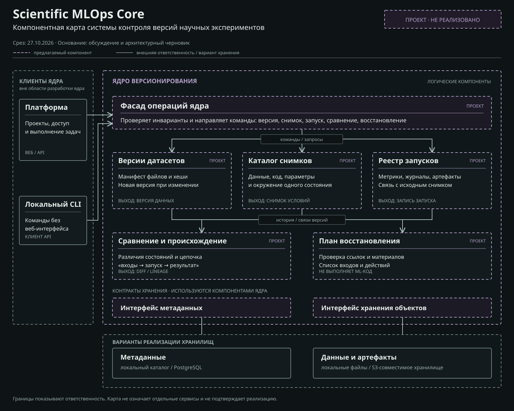

# Компонентная карта ядра

Статус: проект для обсуждения, срез на 27 октября 2026 года. [Открыть SVG-карту](component-map.svg). Карта и описания ниже не подтверждают существование кода или утверждение архитектуры.

## Как читать карту

Компонент означает область ответственности с собственными правилами и данными. Карта не требует выделять каждый компонент в сетевой сервис. Пунктирная фиолетовая рамка и подпись «ПРОЕКТ» означают предложение; серые рамки показывают внешнюю ответственность или возможный способ хранения. Стрелки обозначают основные передачи команд, ссылок на версии и данных. На карте показаны ключевые связи, а не каждый внутренний вызов.

Первый проверочный сценарий относится к ML-эксперименту. Модель версий не должна предполагать, что любой результат обязательно является обученной моделью: артефактом может быть таблица, график, журнал или иной файл исследования.

## Ответственность ядра

| Компонент | Собственные правила и данные | Основной контракт |
| --- | --- | --- |
| Фасад операций | Принимает команды и запросы, проверяет инварианты перед изменением истории. Не содержит правил доступа к пользователям. | Создать версию данных и снимок условий, зарегистрировать итог запуска, получить историю, сравнение или план восстановления. |
| Версии датасетов | Формирует неизменяемый манифест путей, размеров и контрольных сумм файлов; новая публикация не меняет старую версию. | На входе файлы и идентификатор исследования; на выходе идентификатор версии и манифест. |
| Каталог снимков | Связывает выбранные версии входных датасетов с кодом, параметрами, описанием окружения и предыдущим снимком при наличии. | На входе конкретные ссылки на входы; на выходе неизменяемый снимок условий эксперимента. |
| Реестр запусков | Хранит завершённый запуск как отдельный факт, привязанный к снимку, с метриками, журналами и артефактами. | На входе идентификатор снимка и результат выполнения; на выходе новая запись запуска. |
| Сравнение и происхождение | Читает версии и связи, показывает изменения состава данных, параметров и цепочку от входов до результата. Само не меняет историю. | На входе два снимка или идентификатор результата; на выходе различия или цепочка происхождения. |
| План восстановления | Проверяет доступность всех входов выбранного запуска и собирает требуемые действия. Не выполняет вычисления. | На входе идентификатор запуска; на выходе план или перечень отсутствующих материалов. |
| Интерфейс метаданных | Отделяет правила версий от формата хранения манифестов, снимков, записей и ссылок. | Чтение, публикация неизменяемых записей и условное обновление ссылки на текущий снимок. |
| Интерфейс хранения объектов | Отделяет правила версий от размещения крупных файлов данных и артефактов. | Потоковая запись и чтение содержимого по проверяемому идентификатору. |

Снимок условий и запись запуска различаются: один снимок можно выполнить несколько раз, и каждый запуск получит собственный идентификатор и результат. Контрольная сумма файла подтверждает совпадение его байтов, но не гарантирует совпадение метрик при повторном вычислении.

## Граница с платформой

Платформа отвечает за проекты, учётные записи, разрешения, HTTP API, веб-интерфейс и фактическое выполнение задач. Она проверяет право пользователя до обращения к ядру. Локальный CLI может обращаться к тем же операциям ядра без веб-интерфейса. Разделение репозиториев не означает обязательного разделения на два сетевых сервиса.

Исполнитель платформы получает зафиксированные входы, запускает выбранный эксперимент и передаёт итог в реестр запусков. Текущее состояние выполняющейся задачи может храниться на стороне платформы; завершённая запись в ядре остаётся неизменяемой.

## Пример прохождения данных

1. Файлы датасета поступают через платформу или CLI. Ядро получает их контрольные суммы, сохраняет содержимое через интерфейс объектов и публикует манифест версии.
2. Каталог создаёт снимок с ссылками на версии данных, коммит кода, параметры и окружение. Ссылка на текущий снимок обновляется только при совпадении с ожидаемым прежним значением, чтобы обнаруживать одновременное изменение.
3. Платформа выполняет эксперимент. Реестр сохраняет итоговый запуск и ссылки на его выходные артефакты.
4. После изменения данных создаётся новый манифест и новый снимок. Прежний запуск продолжает указывать на прежние версии.
5. Сравнение показывает различия, а план восстановления перечисляет нужные входы и сообщает об отсутствующих файлах или внешних ссылках.

Перед публикацией манифеста содержимое должно быть доступно в хранилище объектов. Точная схема атомарности между хранилищем объектов и метаданных, а также очистка незавершённых загрузок остаются проектными вопросами.

## Хранение и проверка

На карте локальный каталог и PostgreSQL показаны как варианты реализации интерфейса метаданных, локальные файлы и S3-совместимое хранилище - как варианты реализации интерфейса объектов. Это не принятый стек. Логическая принадлежность данных исследованию определяется метаданными и проверкой доступа платформы; физическое устранение дублей не должно открывать доступ к чужому проекту.

Для первого прототипа следует проверить, что изменение входного файла или параметра создаёт различимый новый снимок, что старые запуски сохраняют ссылки на прежние входы, что отсутствие объекта выявляется до восстановления и что второй запуск тех же условий получает отдельную запись. Восстановление условий, повторное выполнение и численное совпадение результатов оцениваются отдельно.

Ветвление и слияние, произвольные графы вычислений, кластерные планировщики и распределённый кэш в эту карту не включены. Открыты формат манифеста, правила идентификации снимков, границы поддерживаемого исследовательского сценария и критерий успешного восстановления.

В SVG встроены шрифты PT Sans и PT Mono. Их лицензии: [PT Sans](licenses/PTSans-OFL.txt) и [PT Mono](licenses/PTMono-OFL.txt).
